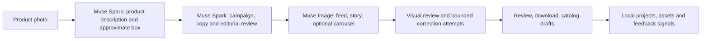

# AdForge AI

**From a product photo to a reviewable advertising campaign.**

AdForge AI helps small businesses turn product photographs into social-media campaign drafts: creative directions, image assets, ad copy, audience ideas, and catalog exports. It is a project for the [Meta Global AI Developer Hackathon](https://dev.meta.ai/events/global-hackathon), built around Meta Model API. Project owner: [damipineda](https://github.com/damipineda).

> **Prototype, not an autopublishing service.** AI-generated images and copy need human review for accuracy, rights, privacy and platform requirements. AdForge does not post advertisements or create campaigns in Meta Ads Manager.

## The problem

A seller may have a product photo but lack the time or design resources to create a coherent campaign for multiple social placements. AdForge starts from that photo, analyzes the product, proposes campaign angles and copy, and generates visuals in matching formats. The goal is to make a useful first draft faster while keeping the merchant in control of the final result.

## What it does

- Accepts up to four JPEG, PNG or WebP photos (8 MB each), with Spanish, Portuguese or English output.
- Plans a campaign from the observed product and creates two feed directions, with separate Instagram and Facebook captions. A vertical story is selected by default; a four-slide carousel can also be requested.
- Generates feed (4:5), story (9:16) and carousel (4:5) artwork, and supports PNG downloads. A Reel here is **not** generated video.
- Reviews the proposed art direction and copy; a visual reviewer inspects generated pieces and compares their compositions. It can attempt up to two visual corrections per campaign and reports review failures or unresolved issues.
- Provides proposed audience segments, a Shopify-shaped product JSON and a Meta Catalog CSV for review. These are drafts, **not verified imports**: the user must supply or verify real product data and publicly accessible image URLs.
- Stores projects, campaigns, image assets and review signals locally in SQLite and `data/files/`. Basic rule candidates are derived from repeated review signals; they are not proof that an ad will perform well.
- Includes a deterministic demo mode that runs without an API key, plus a live Meta mode. In demo mode visual review and image generation are not live-model results.

## Quick start

**Requirements:** Node.js 24 (the project uses the `node:sqlite` module), pnpm 10, and a supported local OS. Node 24.13.0 and pnpm 10.33.2 were used locally.

```bash
pnpm install
```

Create `.env.local` from `.env.local.example`. For a free, offline application demo, set:

```dotenv
AI_PROVIDER=demo
```

Start the app:

```bash
pnpm dev
```

Open [http://localhost:3000](http://localhost:3000), attach a product photo, choose the market and placements, and generate a campaign. The UI streams progress for vision, campaign planning, image generation and review. In demo mode it uses local fixtures and Canvas fallbacks rather than Meta inference.

### Live Meta Model API

Use an eligible Meta Model API key, stored only in `.env.local`:

```dotenv
AI_PROVIDER=meta
MUSE_IMAGE_API_KEY=YOUR_META_MODEL_API_KEY
MUSE_SPARK_MODEL=muse-spark-1.3
MUSE_IMAGE_MODEL=muse-image-1.0
```

Restart the server after changing configuration. If the explicit provider is `meta` and the key is missing, the application falls back to demo; check the provider badge and the `mode` field before interpreting a result as a live test. Meta availability, latency, quotas and costs depend on the provider. Review the current provider terms before using the app at scale. Never commit real keys or sensitive product photos.

## How it works



- **Muse Spark 1.3** performs vision, copywriting, campaign planning and review through Meta Model API `/v1/responses`.
- **Muse Image 1.0** produces artwork using the photo as an image-edit reference through `/v1/images/edits`.
- The internal stage named `sam` currently uses **Muse Spark vision and an approximate bounding box**. A working SAM 3.1 segmentation mask is not integrated. The input background may remain visible, and the generated product or packaging may change.
- Text is rendered by the image model in live pieces, so spelling, spacing and layout are not guaranteed. The local Canvas fallback is a different rendering path, not evidence of live generation quality.
- Model-based reviews can miss errors or flag good work. A review status is not approval to publish. Correction attempts are bounded and can retain the earlier version when verification fails.

More technical details are in [docs/muse-code-usage.md](docs/muse-code-usage.md). The API entry point is [`src/app/api/generate-campaign/route.ts`](src/app/api/generate-campaign/route.ts); the orchestration is in [`src/lib/pipeline/index.ts`](src/lib/pipeline/index.ts).

## Privacy and product fidelity

The original uploaded image is sent to the configured AI provider **without prior anonymization**. Hide license plates, personal documents, addresses and any sensitive information before uploading. Text redaction covers only some patterns. The model-based visual review and UI blocking may fail to detect sensitive details and do not erase data from existing files or campaigns.

Do not assume that generated labels, vehicles, quantities or supplement claims are exact. Check the real product and obtain rights to use the images. Especially for health-related products, do not publish unsupported medical or performance claims.

The local database and files are under `data/`, which is excluded from Git. This prototype does not provide production authentication or multi-tenant access controls; do not expose a local installation or its stored images to the public internet without securing it first.

## Run checks

```bash
pnpm build
pnpm lint
pnpm prompts:check
pnpm review:check
npx -y tsx scripts/copy-review-check.ts
npx -y tsx scripts/privacy-check.ts
```

With the application running in demo mode:

```bash
pnpm demo:check
```

`SMOKE_BASE` can point the smoke script to a different local URL. `pnpm store:check` exercises local persistence and learning; run it only in an isolated disposable workspace because it writes test campaigns and can create persistent rule candidates. Tests using demo or mocked responses do not verify live Meta output or submission eligibility.

## Hackathon context

The project addresses the event's **Build for Your World** theme: using Meta models to help sellers produce campaign drafts. The public event page describes the tracks and theme; the participant portal and official rules govern the actual submission and any required disclosures. A GitHub push alone is not a hackathon submission. Verify the current requirements and submit through the organizers' portal.

## Español

AdForge AI transforma fotos de productos en borradores de campañas para redes: dos piezas de feed, historia y carrusel opcional, con copy, audiencias sugeridas y exportaciones de catálogo. Usa Muse Spark para analizar, redactar y revisar, y Muse Image para generar las piezas. La revisión humana sigue siendo necesaria y los datos sensibles deben ocultarse antes de subir la foto.

## License

No license is currently included. All rights are reserved unless the project owner adds one.
