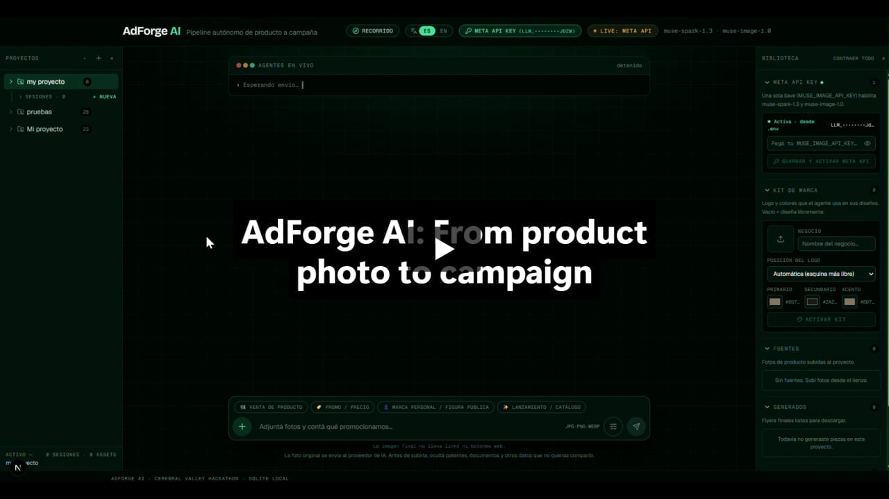
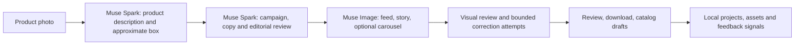

# AdForge AI

[](LICENSE)

**From a product photo to a reviewable advertising campaign.**

**Open-source project · MIT License · [Public source repository](https://github.com/damipineda/AdForge-AI).**

AdForge AI helps small businesses turn product photographs into social-media campaign drafts: creative directions, image assets, ad copy, audience ideas, and catalog exports. It is a project for the [Meta Global AI Developer Hackathon](https://dev.meta.ai/events/global-hackathon), built around Meta Model API. Project owner: [damipineda](https://github.com/damipineda).

## Watch the hackathon demo

**[▶ Watch AdForge AI — Meta Hackathon Demo on YouTube (2:32)](https://youtu.be/R73af6gwxJA)**

[](https://youtu.be/R73af6gwxJA)

The English-captioned walkthrough shows product input, campaign planning, feed and story artwork, visual auditing and selective refinement. The closing screen identifies the original hackathon contributions: the campaign pipeline, visual audit, refinement workflow and campaign history. Runtime generation uses Muse Spark and Muse Image, and the source is released under the MIT License.

Click the preview to watch on YouTube.

> **Prototype, not an autopublishing service.** AI-generated images and copy need human review for accuracy, rights, privacy and platform requirements. AdForge does not post advertisements or create campaigns in Meta Ads Manager.

## The problem

A seller may have a product photo but lack the time or design resources to create a coherent campaign for multiple social placements. AdForge starts from that photo, analyzes the product, proposes campaign angles and copy, and generates visuals in matching formats. The goal is to make a useful first draft faster while keeping the merchant in control of the final result.

## What it does

- Accepts up to four JPEG, PNG or WebP photos (8 MB each), with Spanish, Portuguese or English output.
- Plans a campaign from the observed product and creates two feed directions, with separate Instagram and Facebook captions. A vertical story is selected by default; a four-slide carousel can also be requested.
- Generates feed (4:5), story (9:16) and carousel (4:5) artwork, and supports PNG downloads. A Reel here is **not** generated video.
- Muse Image composes the complete ad: product, scene, editorial typography, benefit pills and CTA. The frontend exports at native resolution without text overlays, cropping or artificial background filling. When a brand kit is configured, its uploaded logo is composited separately onto the exported canvas.
- Each saved feed/story card supports a targeted AI refinement. Muse Spark updates its brief/copy, Muse Image edits that piece using the prior art and all source photos, and the visual agent audits it before replacement. A rejected edit gets one corrective generation with the audit feedback and the same original references, then a fresh audit. Persistent failures show the specific reason (without sensitive details) and preserve the previous version. An unavailable reviewer stops replacement without a blind regeneration. Successful revisions keep their instruction, retry count and audit in campaign history.
- Saved pieces with unresolved image errors offer a one-click automatic correction using their full audit findings, without requiring a written instruction. Campaign diversity preferences (including similar CTA buttons) and external-caption observations do not disable an otherwise usable image's download. Real image failures and privacy findings remain independent per piece.
- A fresh-version action generates a new composition from original source photos, without using the previous failed art as the visual reference. After two failed corrections the automatic action uses this mode as well. The version history links both old and new artwork. A new generation with unresolved non-privacy findings is saved as an explicitly audited draft; unavailable audits and privacy failures still preserve the active version. Fresh generation requires linked original photos.
- Reviews the proposed art direction and copy; a visual reviewer inspects generated pieces and compares their compositions. Only critical findings, privacy issues or failed checks trigger automatic image corrections; minor warnings stay in the report. Each affected piece can receive up to two corrective generations, with at most two pieces correcting concurrently and a shared four-minute review budget. Unaffected images retain their original pixels. Progress names the piece and attempt. The per-piece report separates requested corrections, verified improvements and pending issues. Critical issues or failed checks mark the card as a draft and disable its PNG download until refinement resolves them. Existing saved campaigns are not automatically regenerated.
- Provides proposed audience segments, a Shopify-shaped product JSON and a Meta Catalog CSV for review. These are drafts, **not verified imports**: the user must supply or verify real product data and publicly accessible image URLs.
- Stores projects, campaigns, image assets and review signals locally in SQLite and `data/files/`. Basic rule candidates are derived from repeated review signals; they are not proof that an ad will perform well.
- Provides Spanish/English interface controls, an interactive platform tour, a project brand kit and local Meta API key settings. Keys entered in the UI are stored in the local SQLite database, never returned in full by the settings API; keep that database private.
- Includes a deterministic demo mode that runs without an API key, plus a live Meta mode. In demo mode visual review and image generation are not live-model results.

## Quick start

**Requirements:** Node.js 24 (the project uses the `node:sqlite` module), pnpm 10, and a supported local OS. Node 24.13.0 and pnpm 10.33.2 were used locally.

```bash
pnpm install
```

Create `.env.local` from `.env.local.example`. For a free, offline application demo, set:

```dotenv
AI_PROVIDER=demo
```

Start the app:

```bash
pnpm dev
```

Open [http://localhost:3000](http://localhost:3000), attach a product photo, choose the market and placements, and generate a campaign. The UI streams progress for vision, campaign planning, image generation and review. In demo mode it uses local fixtures and Canvas fallbacks rather than Meta inference.

### Live Meta Model API

Use an eligible Meta Model API key, stored only in `.env.local`:

```dotenv
AI_PROVIDER=meta
MUSE_IMAGE_API_KEY=YOUR_META_MODEL_API_KEY
MUSE_SPARK_MODEL=muse-spark-1.3
MUSE_IMAGE_MODEL=muse-image-1.0
```

Restart the server after changing configuration. If the explicit provider is `meta` and the key is missing, the application falls back to demo; check the provider badge and the `mode` field before interpreting a result as a live test. Meta availability, latency, quotas and costs depend on the provider. Review the current provider terms before using the app at scale. Never commit real keys or sensitive product photos.

## How it works



- **Muse Spark 1.3** performs vision, copywriting, campaign planning and review through Meta Model API `/v1/responses`.
- **Muse Image 1.0** produces artwork using the photo as an image-edit reference through `/v1/images/edits`.
- The internal stage named `sam` currently uses **Muse Spark vision and an approximate bounding box**. A working SAM 3.1 segmentation mask is not integrated. The input background may remain visible, and the generated product or packaging may change.
- Muse composes the full typography and can still misspell copy or alter product labels. The visual audit reports issues, not permission to publish. Older clean-background campaigns can be converted through per-piece AI refinement; no frontend text is added. The demo Canvas fallback does not establish live generation quality.
- Model-based reviews can miss errors or flag good work. A review status is not approval to publish. Correction attempts are bounded and can retain the earlier version when verification fails.

More technical details are in [docs/muse-code-usage.md](docs/muse-code-usage.md). The API entry point is [`src/app/api/generate-campaign/route.ts`](src/app/api/generate-campaign/route.ts); the orchestration is in [`src/lib/pipeline/index.ts`](src/lib/pipeline/index.ts).

## Privacy and product fidelity

The original uploaded image is sent to the configured AI provider **without prior anonymization**. Hide license plates, personal documents, addresses and any sensitive information before uploading. Text redaction covers only some patterns. The model-based visual review and UI blocking may fail to detect sensitive details and do not erase data from existing files or campaigns.

Do not assume that generated labels, vehicles, quantities or supplement claims are exact. Check the real product and obtain rights to use the images. Especially for health-related products, do not publish unsupported medical or performance claims.

The local database and files are under `data/`, which is excluded from Git. This prototype does not provide production authentication or multi-tenant access controls; do not expose a local installation or its stored images to the public internet without securing it first.

## Run checks

```bash
pnpm build
pnpm lint
pnpm prompts:check
pnpm review:check
npx -y tsx scripts/copy-review-check.ts
npx -y tsx scripts/privacy-check.ts
npx -y tsx scripts/refinement-check.ts
npx -y tsx scripts/download-policy-check.ts
npx -y tsx scripts/timeout-state-check.ts
npx -y tsx scripts/art-direction-check.ts
```

With the application running in demo mode:

```bash
pnpm demo:check
```

`SMOKE_BASE` can point the smoke script to a different local URL. `pnpm store:check` exercises local persistence and learning; run it only in an isolated disposable workspace because it writes test campaigns and can create persistent rule candidates. Tests using demo or mocked responses do not verify live Meta output or submission eligibility.

## Hackathon context

The project addresses the event's **Build for Your World** theme: using Meta models to help sellers produce campaign drafts. The public event page describes the tracks and theme; the participant portal and official rules govern the actual submission and any required disclosures. A GitHub push alone is not a hackathon submission. Verify the current requirements and submit through the organizers' portal.

### Original hackathon contributions

The starting point was a standard Create Next App scaffold committed on 23 October 2026 ([`cf40e9e`](https://github.com/damipineda/AdForge-AI/commit/cf40e9e)). That starter, framework dependencies and their stock assets are not claimed as original hackathon work.

The AdForge implementation is recorded in commits dated 28 October–4 November 2026, during the guide's 27 October–4 November building period:

- [`62d770a`](https://github.com/damipineda/AdForge-AI/commit/62d770a): product-photo campaign pipeline using Meta Model API.
- [`4c42959`](https://github.com/damipineda/AdForge-AI/commit/4c42959) and [`727a620`](https://github.com/damipineda/AdForge-AI/commit/727a620): campaign studio and Muse-only inference configuration.
- [`b6a186b`](https://github.com/damipineda/AdForge-AI/commit/b6a186b): integrated campaign artwork, targeted refinement and regeneration, version history, visual audit and error handling, project/brand controls, interface languages and platform tour, with focused verification scripts.

The demo should highlight these implemented application features and distinguish live Muse generation from the offline demo fixtures. The supplied participant guide requires a publicly accessible repository, an accessible three-minute demo video, identification of all contributors, and submission through the CV platform.

### Meta AI contribution

The project owner used Meta AI extensively to help understand the Meta integration and develop, debug and refine the campaign workflow, visual auditing, local database persistence and image storage. In the running application, Muse Spark analyzes products, plans campaigns, writes copy and reviews results; Muse Image generates and refines the artwork. Development assistance and runtime inference are separate roles. See [the integration notes](docs/muse-code-usage.md#hackathon-submission) for attribution.

Older demo footage may display a legacy “SAM 3.1” stage label. The implemented analysis uses **Muse Spark vision**; SAM segmentation masks are not integrated.

## Español

AdForge AI transforma fotos de productos en borradores de campañas para redes: dos piezas de feed, historia y carrusel opcional, con copy, audiencias sugeridas y exportaciones de catálogo. Usa Muse Spark para analizar, redactar y revisar, y Muse Image para generar las piezas. La revisión humana sigue siendo necesaria y los datos sensibles deben ocultarse antes de subir la foto.

Es un proyecto **open source bajo licencia MIT**, con repositorio público. El trabajo original presentado para la hackathon está identificado arriba por funcionalidades y commits; el scaffold y las dependencias conservan sus propias atribuciones.

## License

The original AdForge AI source code and documentation are released under the [MIT License](LICENSE), copyright 2026 damipineda. You may use, modify and redistribute them under its terms.

Dependencies, stock framework assets, third-party trademarks and uploaded product/brand images retain their respective licenses and rights. Meta models and API access are governed by Meta's terms; this repository's license does not license those services or grant rights to third-party assets.

`"private": true` in `package.json` prevents accidental npm publication. It does not make the GitHub repository private or change the MIT source license.
